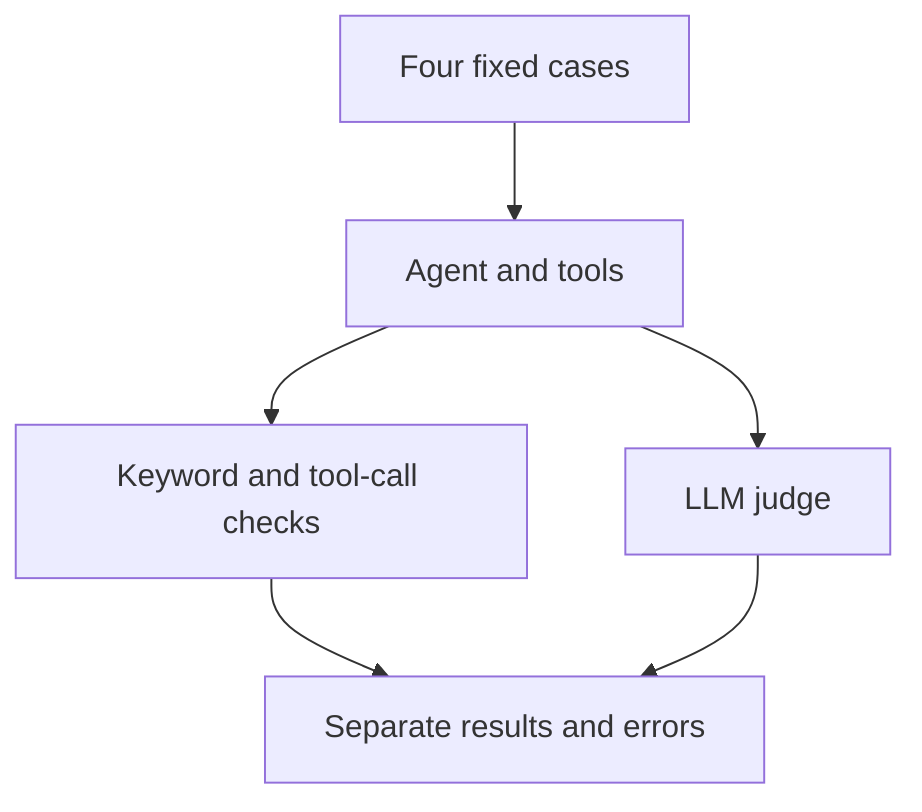

# 🧪 AI Agent Evaluation Harness

Evaluate a local two-tool agent using deterministic checks and an LLM judge.

Built from [Darsh Shah's freeCodeCamp tutorial](https://www.freecodecamp.org/news/how-to-evaluate-ai-agents-with-an-llm-as-a-judge-harness-in-python/).

| 🟦 Learn AI | 🟩 Portfolio | 🟪 Research |
| --- | --- | --- |
| Evaluation and rubrics | Recorded baseline and prompt changes | Separate agent behavior from judge errors |

## Architecture



## Recorded results

| Configuration | Deterministic passes | Judge YES | Judge errors |
| --- | --- | --- | --- |
| Basic prompt, answer-only judge | 3/4 | 3/4 | 0 |
| Stronger prompt, answer-only judge | 4/4 | 3/4 | 0 |
| Tool evidence added | 4/4 | 3/4 | 1 |
| Bounded judge with tool evidence | 4/4 | 3/4 | 0 |

These are individual runs, not reliability estimates.

The stronger prompt corrected a missing word_count request.
The latest judge completed without errors but disagreed with the
required-tool request evidence for Case 4.

See [verification details](docs/tutorial-verification.md).

## Windows PowerShell setup

Install Python 3.14 and Ollama. From this directory, run:

```powershell
py -3.14 -m venv .venv
.\.venv\Scripts\python.exe -m pip install -r requirements.txt
.\.venv\Scripts\python.exe -m pip check
ollama pull qwen3.5:4b
$env:CHAT_MODEL = "qwen3.5:4b"
$env:JUDGE_MODEL = "qwen3.5:4b"
.\.venv\Scripts\python.exe -u .\eval.py
```

Ensure Ollama is running.

## Evidence and limitations

Baseline source snapshots and three run logs are preserved.
The initial basic-prompt result is recorded in the verification document;
a standalone log of that initial run is not included.

Checks inspect answer keywords and requested tool names.
They do not validate arguments, execution success, or tool-result accuracy.
Case 4 skips its keyword check.

Judge errors are unavailable evaluations, not NO verdicts.
The agent has no checkpointer or persistent storage.

Tutorial adaptations include separate summaries, strict verdict parsing,
error reporting, tool evidence in the judge input, and bounded generation.

## Planned extensions

- Validate tool arguments and execution results.
- Save structured evidence and generation metadata.
- Calibrate the judge with known examples.
- Add repeated runs and Build Release and Integration cases.

Previous project:
[Local AI Agent with Tool Calling and Memory](https://github.com/anne500/local-ai-agent-tool-memory),
handoff checkpoint 8be72c2.
