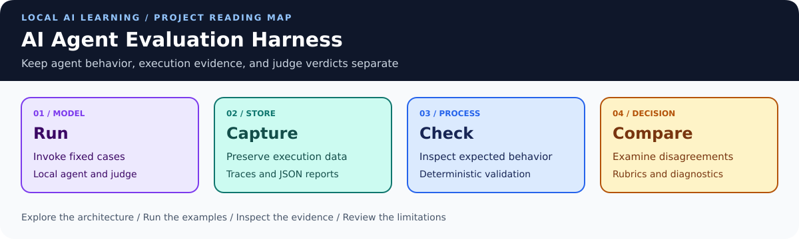
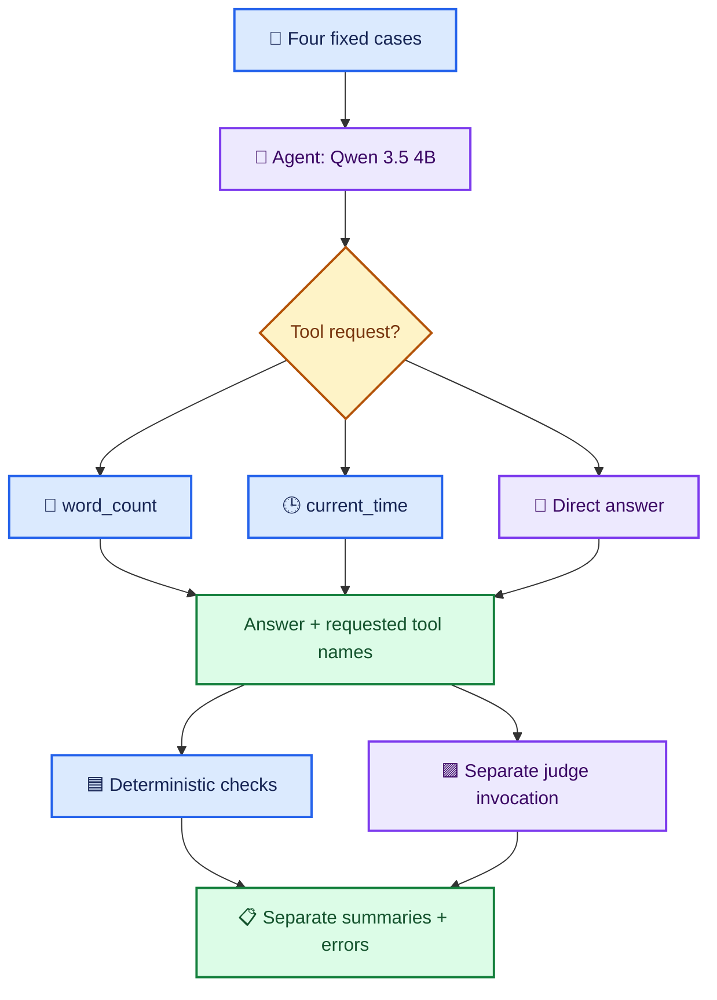
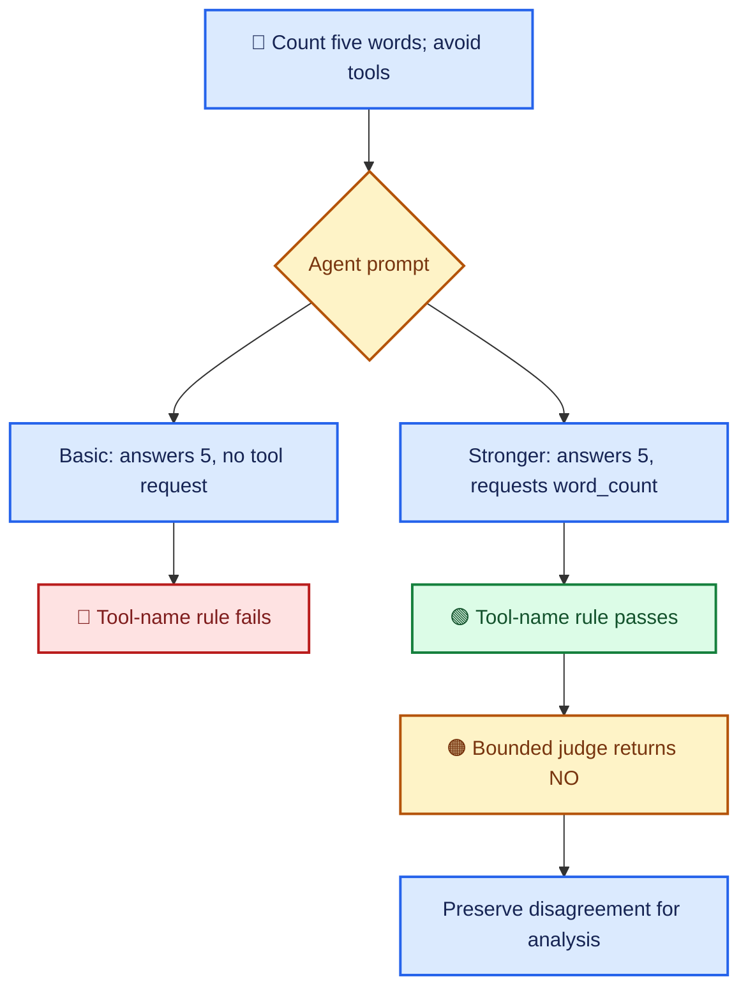
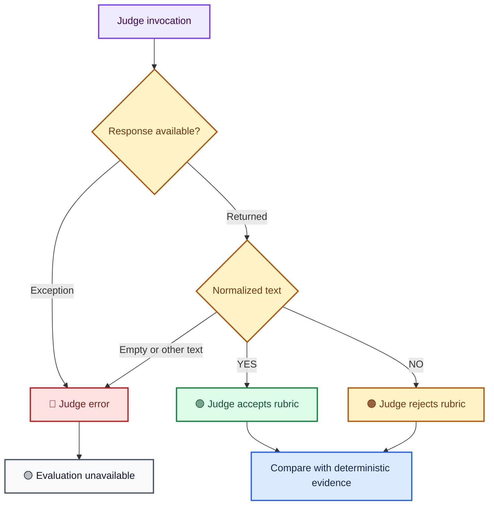
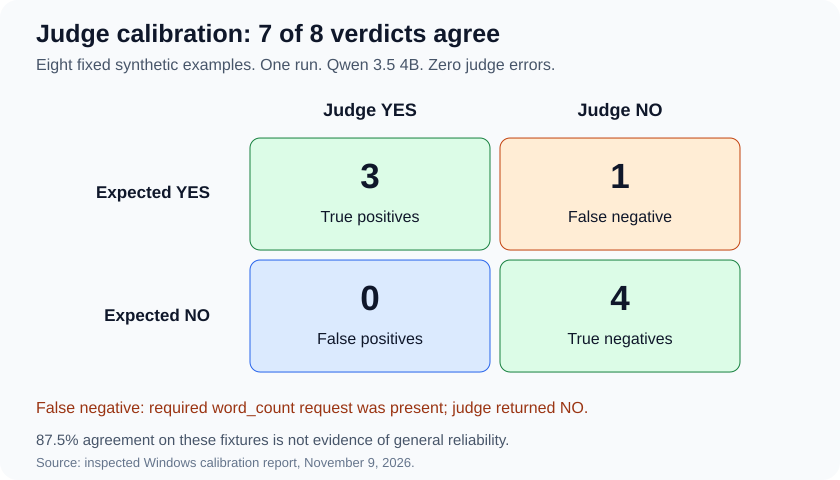
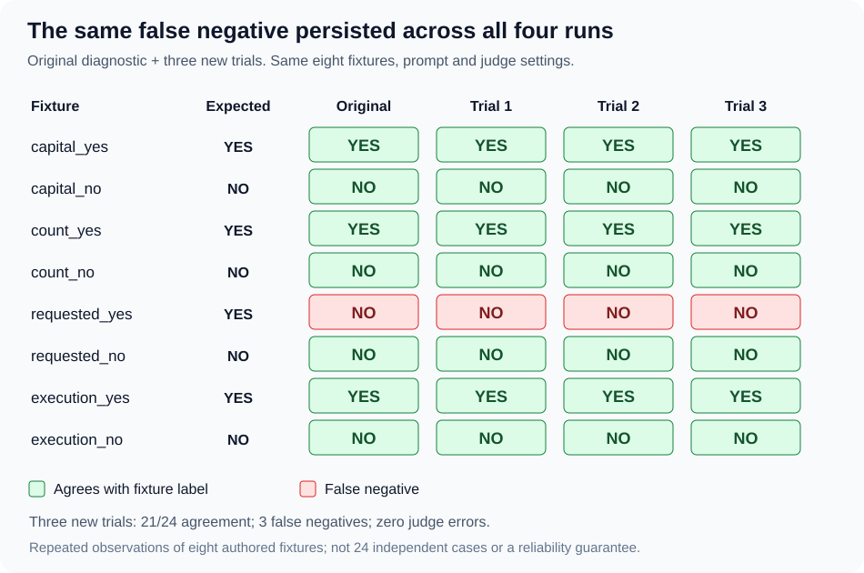
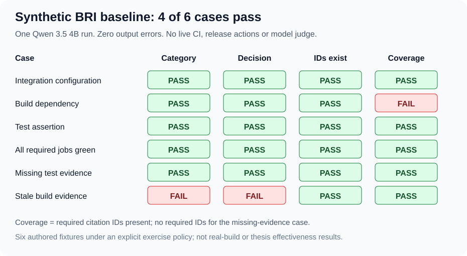

# 🧪 AI Agent Evaluation Harness



🎨 [Shared architecture colors and diagram conventions](VISUAL_STYLE.md)

> **📚 Tutorial foundation:** This learning project is based on [Darsh Shah's freeCodeCamp tutorial](https://www.freecodecamp.org/news/how-to-evaluate-ai-agents-with-an-llm-as-a-judge-harness-in-python/). See [Tutorial Acknowledgment and Attribution](#tutorial-acknowledgment-and-attribution) for the original source and the repository's extensions.


**Run an agent → inspect its behavior → apply rules → ask a judge → compare the evidence.**

A local Python evaluation harness for a two-tool AI agent. This project records
both a successful prompt improvement and a model-judge disagreement.

Built from [Darsh Shah's freeCodeCamp tutorial](https://www.freecodecamp.org/news/how-to-evaluate-ai-agents-with-an-llm-as-a-judge-harness-in-python/).
The badges report the latest recorded four-case run, not live CI status.

| 🟦 Learn AI | 🟩 Show on GitHub | 🟪 Build toward PhD research |
| --- | --- | --- |
| Tool calling, rubrics, and regression checks | Source snapshots, readable logs, and documented results | Evaluation methods for Build Release and Integration Engineering |
| Compare rules with model judgment | Preserve failures and disagreements | Separate system behavior from evaluator behavior |

> **📍 Current checkpoint:** tutorial sequence completed with documented adaptations.
> Execution validation passed 15 Windows offline tests and one four-case model run.
> Judge calibration is verified: one inspected run gave 7/8 agreement and one false negative.
> Three same-model repeats and one exploratory second-model comparison are verified.
> The synthetic BRI baseline is inspected: 4/6 complete passes, two preserved failures.
> Tutorial and selected learning extensions are complete at this checkpoint.
> Real-build studies and broader benchmarking remain planned.

<a id="explore-the-project"></a>

## 🧭 Explore the project

[🧩 Architecture](#architecture) · [🚀 Setup](#windows-powershell-setup) · [🧪 Results & verification](#recorded-results) · [🗂️ Evidence & guides](#evidence-map) · [🎨 Visual standard](VISUAL_STYLE.md)
[Case 4](#case-4-correct-answer-missing-tool-then-judge-disagreement) ·
[Setup](#windows-powershell-setup) ·
[Evidence](#evidence-map) · [Roadmap](#learning-and-extension-roadmap)

<a id="architecture"></a>

## 🧩 Architecture

The agent and judge are separate model invocations using the same local model.
The judge has no tools bound to it. The agent has two tools and no checkpointer
or persistent note/fact storage.



<a id="what-each-evaluator-can-establish"></a>

### 🔬 What each evaluator can establish

| Evaluator | Current evidence | Practical limit |
| --- | --- | --- |
| 🔤 Keyword check | Required substring occurs in the answer | A substring is weaker than exact semantic correctness |
| 🔧 Tool-name check | Expected requested tool name occurs in messages | Does not validate arguments or successful execution; extra tool calls can pass |
| 🧑‍⚖️ LLM judge | Question, answer, requested names, and rubric | Can disagree with evidence or fail to return a valid verdict |
| 📋 Combined count | Both rules pass and judge returns YES | Must be read alongside judge errors and separate counts |

For cases expecting no tool, the rule requires an empty requested-tool list.
For Case 4, the keyword check is skipped because the configured keyword is
`None`; its printed `keyword=True` is not an answer-correctness finding.

<a id="recorded-results"></a>

## 📊 Recorded results

**Single observed runs. Four cases per configuration. No reliability estimate.**


Blue shows rule passes, purple shows judge YES, and amber shows judge errors.
Errors are unavailable evaluations; the series are separate measures, not additive totals.

| Stage | Agent prompt | Judge evidence/configuration | 🟦 Rule passes | 🟪 YES | 🔴 Judge errors |
| --- | --- | --- | ---: | ---: | ---: |
| ① Baseline | Basic | Answer only | 3/4 | 3/4 | 0 |
| ② Prompt update | Stronger tool-use instructions | Answer only | 4/4 | 3/4 | 0 |
| ③ Tool evidence | Stronger | Answer + requested tool names | 4/4 | 3/4 | 1 |
| ④ Bounded judge | Stronger | Tool names + bounded generation | **4/4** | **3/4** | **0** |

All four runs reported zero agent errors. Stage ③ had three YES verdicts
and one unavailable verdict, not a NO verdict for the fourth case.
Each run's combined pass count was 3/4, for different underlying reasons.

<a id="latest-bounded-run-by-case"></a>

### 📊 Latest bounded run by case

| Case | Requested tools | Rule result | Judge | Interpretation |
| --- | --- | --- | --- | --- |
| 🕒 Current time | `current_time` | ✅ Pass | YES | Both evaluators accept |
| 🔢 Word count | `word_count` | ✅ Pass | YES | Both evaluators accept |
| 🌍 Capital of France | None | ✅ Pass | YES | Direct answer accepted |
| 🧪 Word count + “Avoid tool use” | `word_count` | ✅ Pass | NO | Judge disagrees with required-tool request evidence |

See the [full verification record](docs/tutorial-verification.md) and
[latest bounded-run log](bounded-judge-20261109-000546.log).

<a id="case-4-correct-answer-missing-tool-then-judge-disagreement"></a>

## 🔀 Case 4: correct answer, missing tool, then judge disagreement

For this tutorial, word-count requests are expected to use the counting tool.
The fourth case deliberately includes a conflicting request to avoid tools.
This expectation is an application policy chosen for the exercise.



The prompt change corrected the observed missing request. The later NO verdict
does not erase that trace evidence. Its cause remains unresolved.
Prompt instructions also asked the agent to name the tool in its answer;
the latest Case 4 answer did not do so. The current rules do not check that instruction.

<a id="judge-diagnostics"></a>

### 🔬 Judge diagnostics

| Diagnostic | Visible content | Stop reason | Output tokens | Approximate duration |
| --- | --- | --- | ---: | ---: |
| Default judge configuration | Empty | `length` | 4,013 | 537 seconds |
| Thinking disabled + token cap | `NO` | `stop` | 2 | 49.6 seconds |

The second diagnostic included about 46.9 seconds of model loading.
These were different configurations and individual calls, not a controlled
latency benchmark. The first result establishes length-limited generation;
it does not establish why no visible content was returned.

<a id="read-verdicts-and-errors-separately"></a>

## 🚦 Read verdicts and errors separately



The current parser accepts only normalized `YES` or `NO`.
It does not yet inspect generation metadata for truncation during full runs.
A valid verdict is an evaluator output, not independent proof of correctness.

<a id="windows-powershell-setup"></a>

## 🚀 Windows PowerShell setup

Verified environment: Windows PowerShell, Python 3.14.4, pinned dependencies,
and local `qwen3.5:4b`. Install Python, Git, and Ollama, then run:

```powershell
git clone https://github.com/anne500/ai-agent-evaluation-harness.git
Set-Location ai-agent-evaluation-harness

py -3.14 -m venv .venv
.\.venv\Scripts\python.exe -m pip install -r requirements.txt
.\.venv\Scripts\python.exe -m pip check

ollama pull qwen3.5:4b
$env:CHAT_MODEL = "qwen3.5:4b"
$env:JUDGE_MODEL = "qwen3.5:4b"

.\.venv\Scripts\python.exe -u .\eval.py
```

Ensure Ollama is running. Agent and judge models can be selected independently.
Other model combinations have not been systematically evaluated here.

| Setting | Agent | Judge |
| --- | --- | --- |
| Temperature | 0 | 0 |
| Thinking control | Model default | `reasoning=False` |
| Generation cap | Model default | `num_predict=128` |
| Client timeout setting | Default | 120 seconds |
| Agent graph recursion limit | 20 | Not applicable |

The client timeout setting is not a total wall-clock deadline for the full suite.
The agent has no explicit generation cap or client timeout in this checkpoint.
The separate execution runner reuses that same agent configuration.

<a id="evidence-map"></a>

## 🗂️ Evidence map

| File | Purpose |
| --- | --- |
| [agent.py](agent.py) | Current stronger-prompt agent |
| [agent.baseline.py](agent.baseline.py) | Preserved basic-prompt agent |
| [eval.py](eval.py) | Current harness with bounded judge |
| [Answer-only snapshot](eval.answer-only-20261108-153447.py) | Harness before tool evidence was added |
| [Pre-bounded snapshot](eval.before-bounded-20261109-000546.py) | Harness before bounded judge configuration |
| [Prompt-update log](prompt-update-20261108-151924.log) | Stronger prompt with answer-only judge |
| [Tool-evidence log](trace-aware-20261108-153447.log) | Run containing empty judge response |
| [Bounded-judge log](bounded-judge-20261109-000546.log) | Latest recorded four-case run |
| [Verification record](docs/tutorial-verification.md) | Results, diagnostic observations, and scope |
| [requirements.txt](requirements.txt) | Pinned dependency versions |
| [Execution guide](docs/execution-validation.md) | Extension checks, offline tests, and model-run instructions |
| [Structured evidence guide](docs/structured-evidence.md) | JSON fields, checkpoint lifecycle, recovery, and report inspection |
| [Judge calibration guide](docs/judge-calibration.md) | Labeled fixtures, confusion matrix, errors, and judge-run commands |

The initial basic-prompt run and separate diagnostics are documented from supplied
terminal transcripts; standalone logs for them are not included.
Snapshots preserve source versions. Rerunning them may produce different outputs.

<a id="execution-validation-extension"></a>

## 🧪 Execution-validation extension

The separate [execution runner](eval_execution.py) adds exact argument checks,
call/result pairing, error-status rejection, and tool-value validation.
[Read the illustrated extension guide](docs/execution-validation.md).

| 🟢 Offline checker tests | 🟢 Windows agent execution |
| --- | --- |
| 15/15 passed on Linux and Windows | 4/4 passed with Qwen 3.5 4B; zero agent/trace errors; exit code 0 |

See the [November 9 Windows evidence record](docs/windows-execution-20261109.md).
This is one recorded agent run, not a reliability estimate. No judge was invoked.

```powershell
.\.venv\Scripts\python.exe -m unittest discover -s tests -v
.\.venv\Scripts\python.exe -u .\eval_execution.py
```

This runner does not invoke an LLM judge. The results and chart above remain
the recorded tutorial runs, not results from the new extension.

<a id="structured-json-evidence"></a>

## 🗂️ Structured JSON evidence

The [execution runner](eval_execution.py) now checkpoints a versioned JSON report
under `results/<run-id>/report.json`. It records call arguments, result IDs,
invocation bounds, per-message model metadata, source hashes, and outcomes.

🟢 **26 offline tests passed on Linux and Windows.** A real Windows run passed
**4/4** with JSON persistence. The supplied report's traces and metadata were
inspected, its execution checks recomputed, and all six source hashes matched
the recorded commit with the Windows checkout's formatting.

[Read the structured evidence audit](docs/structured-evidence-verification-20261109.md).
This is one inspected report, not a reliability estimate.

[Illustrated guide and report inspection commands](docs/structured-evidence.md).

Generated reports are ignored by Git until deliberately shared. No LLM judge is
invoked by this runner, and the historical results chart remains unchanged.

<a id="judge-calibration-diagnostics"></a>

## 🔬 Judge calibration diagnostics

[Eight fixed synthetic examples](judge_calibration.py) test answer quality,
recorded tool requests, and successful execution. Four labels are YES and four NO.
Expected labels are withheld from judge input.

The [calibration runner](eval_calibration.py) saves raw responses and reports
agreement, disagreements, confusion-matrix counts, and judge errors separately.
It rejects length-truncated verdicts and does not retry.

🟢 **41 offline tests passed on Linux and Windows.** The inspected calibration run
returned **7/8 agreement**, one false negative and zero judge errors.
These authored fixtures are a small diagnostic, not a held-out research benchmark.



[Read the calibration evidence audit](docs/calibration-verification-20261109.md).
The required tool request was present in the false-negative fixture; its NO
verdict is preserved rather than relabeled as a pass.

[Colored flow diagram, fixtures, metrics, and Windows commands](docs/judge-calibration.md).

<a id="repeated-calibration-observations"></a>

## 📊 Repeated calibration observations

Three additional trials preserved the fixtures, prompts and judge settings.
Each returned **7/8 agreement**, the same `requested_yes` false negative,
and zero judge errors. Their saved reports and batch summary were inspected.



[Read the repeat-batch evidence audit](docs/calibration-repeats-20261109.md).

The false negative occurred in all four recorded calibration runs. These are
repeated observations of eight fixtures; they do not add independent cases
or establish general reliability. Further identical reruns are unnecessary
for this checkpoint.

<a id="exploratory-judge-model-comparison"></a>

## 🔬 Exploratory judge-model comparison

| Judge | Runs | Agreement per run | False-negative fixtures |
| --- | ---: | --- | --- |
| Qwen 3.5 4B | 4 | 7/8 | `requested_yes` |
| Llama 3.2 3B | 1 | 6/8 | `count_yes`, `requested_yes` |

All saved prompts and fixtures match; the recorded configuration differs only
in the requested model. Both judges returned valid verdicts without errors.
Unequal repetitions on eight authored fixtures do not establish a general ranking.

[Inspected report, colored verdict comparison and limitations](docs/judge-model-comparison-20261109.md).

<a id="synthetic-build-release-and-integration-pilot"></a>

## 🟪 Synthetic Build Release and Integration pilot

Six authored evidence bundles exercise integration configuration failures,
missing build dependencies, assertion failures, complete green evidence,
missing evidence and stale evidence.

The [pilot runner](eval_bri.py) evaluates classification labels and citation IDs
with deterministic checks. It makes no live CI or release action and invokes no
LLM judge. This is a supplied-evidence classification task, not a tool-calling agent.

🟢 **58 offline tests passed on Linux and Windows.** One inspected Qwen run
produced **4/6 complete passes**, two model-output failures and zero output errors.
The missing dependency case omitted its required detail citation. The stale
build case was incorrectly labeled ready despite a commit mismatch.



[Read the BRI baseline audit](docs/bri-pilot-verification-20261109.md).
These synthetic fixtures are not thesis results or real repository build logs.

[Colored workflow, cases, scoring, limitations and Windows commands](docs/bri-pilot.md).

<a id="learning-and-extension-roadmap"></a>

## 🧭 Learning and extension roadmap

**🟦 Learn AI · 🟩 Portfolio evidence · 🟪 PhD research · 🟠 Planned work**

| Stage | Status | Deliverable |
| --- | --- | --- |
| 1. Tutorial baseline | ✅ Recorded | Two tools, four cases, rules, model judge |
| 2. Prompt change and rerun | ✅ Recorded | Missing tool request corrected in observed run |
| 3. Judge diagnostics and bounds | ✅ Recorded adaptation | Empty-output evidence and bounded judge configuration |
| 4. Visual GitHub documentation | ✅ Included here | Architecture, results, verdict flow, and evidence map |
| 5. Execution validation | ✅ Verified in one Windows run | 15 offline tests; 4/4 agent cases with exact arguments, paired results, status and values |
| 6. Structured evidence | ✅ Windows report inspected | 26 tests; 4/4 run; saved traces, timing, metadata and source hashes verified |
| 7. Judge calibration | ✅ Windows report inspected | 41 tests; 7/8 agreement, one false negative, zero judge errors |
| 8. Repeated runs and model comparison | ✅ Repeat and exploratory comparison reports inspected | Qwen: 7/8 each in four runs; Llama: 6/8 in one run; same eight fixtures |
| 9. BRI evaluation cases | ✅ Synthetic baseline inspected | 58 Windows tests; 4/6 full passes, missing detail citation and stale-evidence decision preserved |

<a id="connection-to-build-release-and-integration-engineering"></a>

### 🟪 Connection to Build Release and Integration Engineering

| Current learning | Potential BRI adaptation | Evidence still needed |
| --- | --- | --- |
| Requested-tool checks | Did a diagnosis agent request the relevant build log? | Successful retrieval and correct artifact identity |
| Answer checking | Does a diagnosis match known failure evidence? | Labeled cases and stronger correctness checks |
| Judge disagreement | Can a model evaluator misjudge an engineering answer? | Calibrated rubric and human-reviewed labels |
| Preserved runs | Can a reviewer reproduce an evaluation procedure? | Structured records and repeated-run protocol |

These are methodological connections. The repository now includes time,
counting, general-knowledge cases and six authored synthetic BRI fixtures.
It contains no real-build BRI experiment or thesis results.

<a id="tutorial-adaptations-and-scope"></a>

<a id="tutorial-acknowledgment-and-attribution"></a>

## 📚 Tutorial Acknowledgment and Attribution

We acknowledge **Darsh Shah** as the author of the foundational tutorial published by **freeCodeCamp**:

**[How to Evaluate AI Agents with an LLM-as-a-Judge Harness in Python](https://www.freecodecamp.org/news/how-to-evaluate-ai-agents-with-an-llm-as-a-judge-harness-in-python/)**  
Published: July 17, 2026.

| Credit and provenance | Description |
| --- | --- |
| 👨‍🏫 Original author | Darsh Shah |
| 📚 Publisher | freeCodeCamp |
| 🧱 Tutorial foundation | An agent evaluated on fixed cases using deterministic checks and a model judge, followed by a prompt change and rerun. |
| 🛠️ Repository adaptations and extensions | Execution validation, structured evidence, bounded judge diagnostics, calibration and repeat runs, exploratory model comparison, and synthetic BRI cases. |

The tutorial is credited for the original learning foundation. Repository-specific adaptations, experiments, verification records, and research connections are documented separately in the project documentation.


| Layer | Included |
| --- | --- |
| 📘 Tutorial sequence | Basic agent, fixed cases, keyword/tool checks, YES/NO judge, prompt update and rerun |
| 🛠️ Adaptations | Model environment variables, separate summaries, strict verdict parsing, errors, recursion limit, tool evidence, bounded judge |
| 🔧 Verified extension | Separate execution runner: 15 Windows offline tests and 4/4 model-driven cases; no judge |
| 📦 Verified extension | JSON evidence and partial-run checkpoints; 26 Windows tests and one inspected 4/4 report |
| 🧑‍⚖️ Verified extension | Judge calibration: 41 Windows tests and inspected 7/8 diagnostic agreement |
| 🔁 Verified extension | Three same-model repeats inspected; same 7/8 pattern in each |
| 🔎 Verified extension | One exploratory Llama judge run inspected: 6/8 agreement; no general ranking |
| 🟪 Verified pilot | Six synthetic BRI cases; inspected 4/6 baseline, two model failures, no output errors |
| 🔬 Future extensions | Broader benchmarking and studies using identified real build artifacts |

The agent does not use session memory or persistent storage. When adapting the
previous memory-enabled agent, use unique thread IDs for independent cases,
shared IDs only for related turns, and isolated evaluation storage.

Previous learning projects:
[Multi-Agent Study Guide](https://github.com/anne500/multi-agent-study-guide) ·
[Local AI Agent with Tool Calling and Memory](https://github.com/anne500/local-ai-agent-tool-memory)
(handoff `8be72c2`).

Original tutorial evidence checkpoint: [3aa540a](https://github.com/anne500/ai-agent-evaluation-harness/commit/3aa540a).
