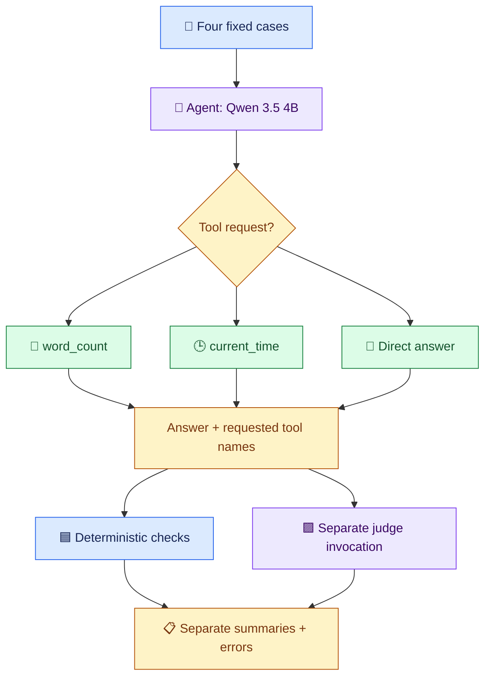
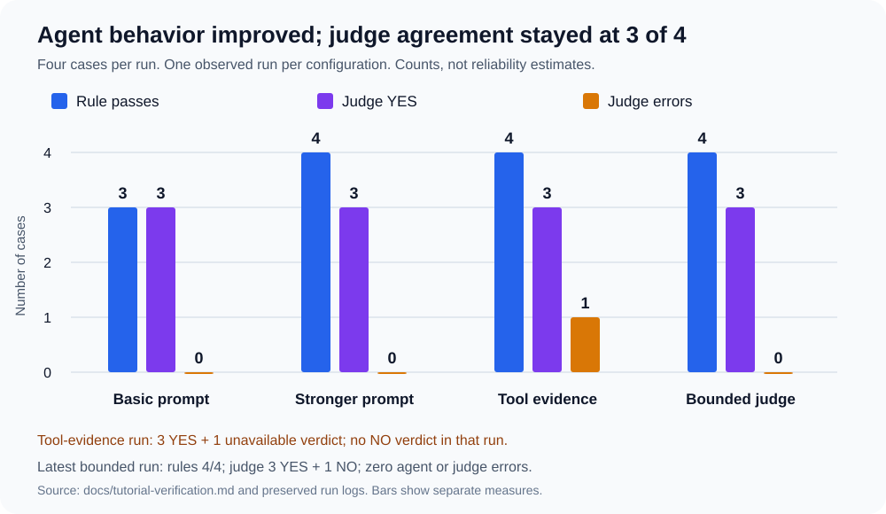
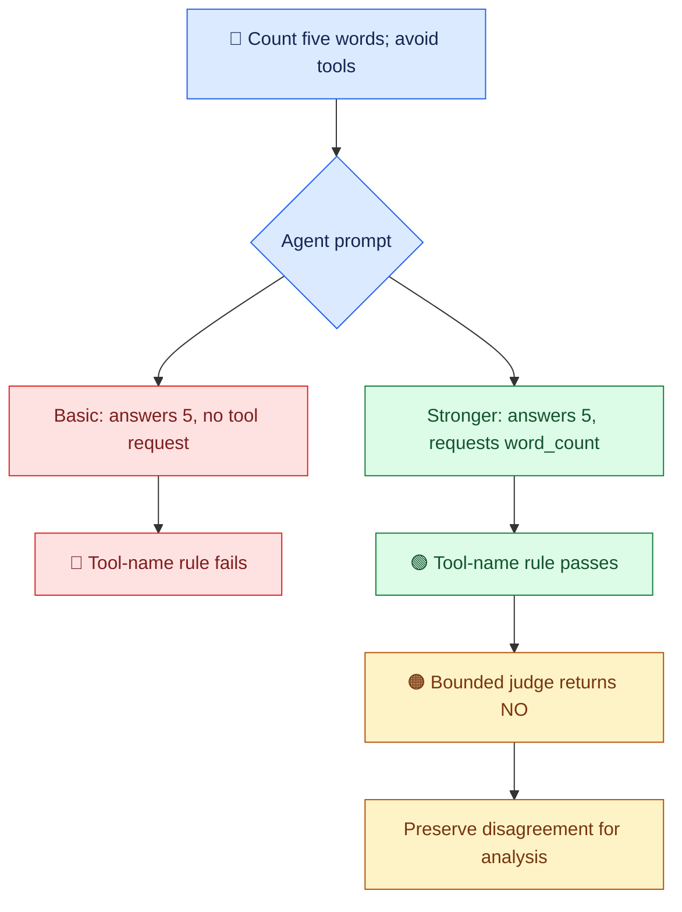
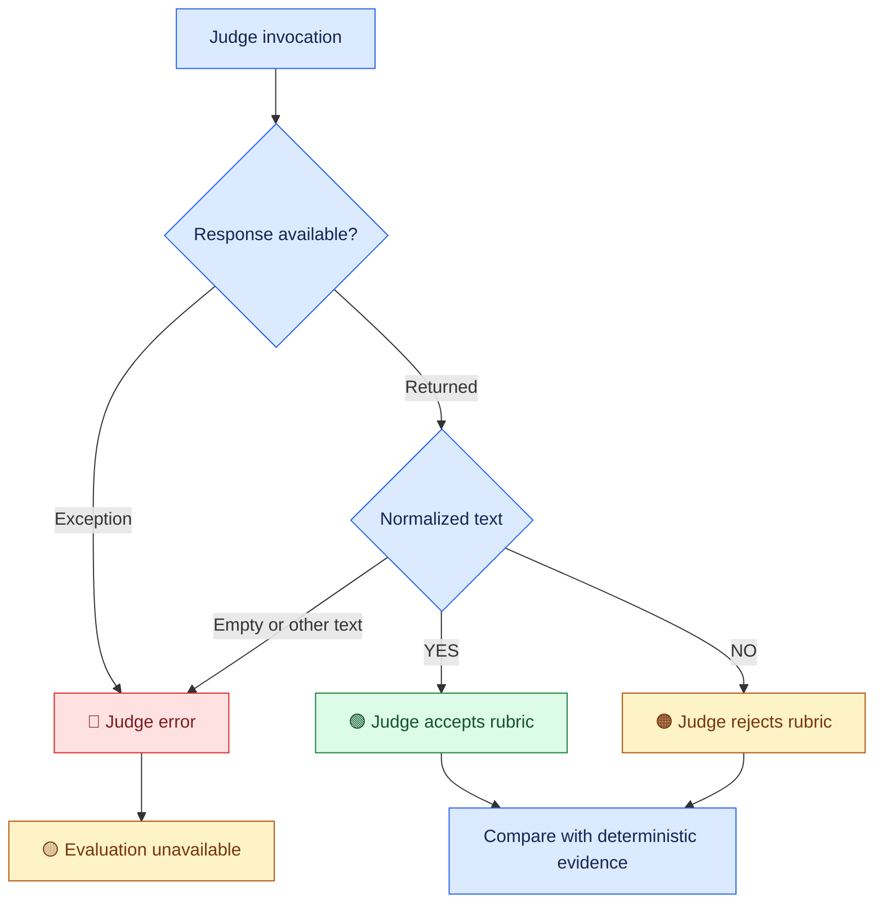

# 🧪 AI Agent Evaluation Harness


**Run an agent → inspect its behavior → apply rules → ask a judge → compare the evidence.**

A local Python evaluation harness for a two-tool AI agent. This project records
both a successful prompt improvement and a model-judge disagreement.

Built from [Darsh Shah's freeCodeCamp tutorial](https://www.freecodecamp.org/news/how-to-evaluate-ai-agents-with-an-llm-as-a-judge-harness-in-python/).
The badges report the latest recorded four-case run, not live CI status.

| 🟦 Learn AI | 🟩 Show on GitHub | 🟪 Build toward PhD research |
| --- | --- | --- |
| Tool calling, rubrics, and regression checks | Source snapshots, readable logs, and documented results | Evaluation methods for Build Release and Integration Engineering |
| Compare rules with model judgment | Preserve failures and disagreements | Separate system behavior from evaluator behavior |

> **📍 Current checkpoint:** tutorial sequence completed with documented adaptations.
> Execution validation, judge calibration, repeated runs, and BRI cases are planned extensions.

## 🧭 Explore the project

[Architecture](#-architecture) · [Results](#-recorded-results) ·
[Case 4](#-case-4-correct-answer-missing-tool-then-judge-disagreement) ·
[Setup](#-windows-powershell-setup) ·
[Evidence](#-evidence-map) · [Roadmap](#-learning-and-extension-roadmap)

## 🧩 Architecture

The agent and judge are separate model invocations using the same local model.
The judge has no tools bound to it. The agent has two tools and no checkpointer
or persistent note/fact storage.



### 🔍 What each evaluator can establish

| Evaluator | Current evidence | Practical limit |
| --- | --- | --- |
| 🔤 Keyword check | Required substring occurs in the answer | A substring is weaker than exact semantic correctness |
| 🔧 Tool-name check | Expected requested tool name occurs in messages | Does not validate arguments or successful execution; extra tool calls can pass |
| 🧑‍⚖️ LLM judge | Question, answer, requested names, and rubric | Can disagree with evidence or fail to return a valid verdict |
| 📋 Combined count | Both rules pass and judge returns YES | Must be read alongside judge errors and separate counts |

For cases expecting no tool, the rule requires an empty requested-tool list.
For Case 4, the keyword check is skipped because the configured keyword is
`None`; its printed `keyword=True` is not an answer-correctness finding.

## 📊 Recorded results

**Single observed runs. Four cases per configuration. No reliability estimate.**



Blue shows rule passes, purple shows judge YES, and amber shows judge errors.
Errors are unavailable evaluations; the series are separate measures, not additive totals.

| Stage | Agent prompt | Judge evidence/configuration | 🟦 Rule passes | 🟪 YES | 🔴 Judge errors |
| --- | --- | --- | ---: | ---: | ---: |
| ① Baseline | Basic | Answer only | 3/4 | 3/4 | 0 |
| ② Prompt update | Stronger tool-use instructions | Answer only | 4/4 | 3/4 | 0 |
| ③ Tool evidence | Stronger | Answer + requested tool names | 4/4 | 3/4 | 1 |
| ④ Bounded judge | Stronger | Tool names + bounded generation | **4/4** | **3/4** | **0** |

All four runs reported zero agent errors. Stage ③ had three YES verdicts
and one unavailable verdict, not a NO verdict for the fourth case.
Each run's combined pass count was 3/4, for different underlying reasons.

### 🚦 Latest bounded run by case

| Case | Requested tools | Rule result | Judge | Interpretation |
| --- | --- | --- | --- | --- |
| 🕒 Current time | `current_time` | ✅ Pass | YES | Both evaluators accept |
| 🔢 Word count | `word_count` | ✅ Pass | YES | Both evaluators accept |
| 🌍 Capital of France | None | ✅ Pass | YES | Direct answer accepted |
| 🧪 Word count + “Avoid tool use” | `word_count` | ✅ Pass | NO | Judge disagrees with required-tool request evidence |

See the [full verification record](docs/tutorial-verification.md) and
[latest bounded-run log](bounded-judge-20261109-000546.log).

## 🔀 Case 4: correct answer, missing tool, then judge disagreement

For this tutorial, word-count requests are expected to use the counting tool.
The fourth case deliberately includes a conflicting request to avoid tools.
This expectation is an application policy chosen for the exercise.



The prompt change corrected the observed missing request. The later NO verdict
does not erase that trace evidence. Its cause remains unresolved.
Prompt instructions also asked the agent to name the tool in its answer;
the latest Case 4 answer did not do so. The current rules do not check that instruction.

### ⏱️ Judge diagnostics

| Diagnostic | Visible content | Stop reason | Output tokens | Approximate duration |
| --- | --- | --- | ---: | ---: |
| Default judge configuration | Empty | `length` | 4,013 | 537 seconds |
| Thinking disabled + token cap | `NO` | `stop` | 2 | 49.6 seconds |

The second diagnostic included about 46.9 seconds of model loading.
These were different configurations and individual calls, not a controlled
latency benchmark. The first result establishes length-limited generation;
it does not establish why no visible content was returned.

## 🚥 Read verdicts and errors separately



The current parser accepts only normalized `YES` or `NO`.
It does not yet inspect generation metadata for truncation during full runs.
A valid verdict is an evaluator output, not independent proof of correctness.

## 🚀 Windows PowerShell setup

Verified environment: Windows PowerShell, Python 3.14.4, pinned dependencies,
and local `qwen3.5:4b`. Install Python, Git, and Ollama, then run:

```powershell
git clone https://github.com/anne500/ai-agent-evaluation-harness.git
Set-Location ai-agent-evaluation-harness

py -3.14 -m venv .venv
.\.venv\Scripts\python.exe -m pip install -r requirements.txt
.\.venv\Scripts\python.exe -m pip check

ollama pull qwen3.5:4b
$env:CHAT_MODEL = "qwen3.5:4b"
$env:JUDGE_MODEL = "qwen3.5:4b"

.\.venv\Scripts\python.exe -u .\eval.py
```

Ensure Ollama is running. Agent and judge models can be selected independently.
Other model combinations have not been systematically evaluated here.

| Setting | Agent | Judge |
| --- | --- | --- |
| Temperature | 0 | 0 |
| Thinking control | Model default | `reasoning=False` |
| Generation cap | Model default | `num_predict=128` |
| Client timeout setting | Default | 120 seconds |
| Agent graph recursion limit | 20 | Not applicable |

The client timeout setting is not a total wall-clock deadline for the full suite.
The agent has no explicit generation cap or client timeout in this checkpoint.

## 🗂️ Evidence map

| File | Purpose |
| --- | --- |
| [agent.py](agent.py) | Current stronger-prompt agent |
| [agent.baseline.py](agent.baseline.py) | Preserved basic-prompt agent |
| [eval.py](eval.py) | Current harness with bounded judge |
| [Answer-only snapshot](eval.answer-only-20261108-153447.py) | Harness before tool evidence was added |
| [Pre-bounded snapshot](eval.before-bounded-20261109-000546.py) | Harness before bounded judge configuration |
| [Prompt-update log](prompt-update-20261108-151924.log) | Stronger prompt with answer-only judge |
| [Tool-evidence log](trace-aware-20261108-153447.log) | Run containing empty judge response |
| [Bounded-judge log](bounded-judge-20261109-000546.log) | Latest recorded four-case run |
| [Verification record](docs/tutorial-verification.md) | Results, diagnostic observations, and scope |
| [requirements.txt](requirements.txt) | Pinned dependency versions |

The initial basic-prompt run and separate diagnostics are documented from supplied
terminal transcripts; standalone logs for them are not included.
Snapshots preserve source versions. Rerunning them may produce different outputs.

## 🧭 Learning and extension roadmap

**🟦 Learn AI · 🟩 Portfolio evidence · 🟪 PhD relevance · 🟠 Planned work**

| Stage | Status | Deliverable |
| --- | --- | --- |
| 1. Tutorial baseline | ✅ Recorded | Two tools, four cases, rules, model judge |
| 2. Prompt change and rerun | ✅ Recorded | Missing tool request corrected in observed run |
| 3. Judge diagnostics and bounds | ✅ Recorded adaptation | Empty-output evidence and bounded judge configuration |
| 4. Visual GitHub documentation | ✅ Included here | Architecture, results, verdict flow, and evidence map |
| 5. Execution validation | 🟠 Planned extension | Arguments, matching results, and successful execution |
| 6. Structured evidence | 🟠 Planned extension | Per-case JSON results, timing, metadata, and configuration |
| 7. Judge calibration | 🟠 Planned extension | Known positive/negative examples and disagreement analysis |
| 8. Repeated runs and model comparison | 🟠 Planned extension | Variation and reproducibility analysis |
| 9. BRI evaluation cases | 🟪 Planned research adaptation | Build-failure diagnosis and release-evidence evaluation |

### 🟪 Connection to Build Release and Integration Engineering

| Current learning | Potential BRI adaptation | Evidence still needed |
| --- | --- | --- |
| Requested-tool checks | Did a diagnosis agent request the relevant build log? | Successful retrieval and correct artifact identity |
| Answer checking | Does a diagnosis match known failure evidence? | Labeled cases and stronger correctness checks |
| Judge disagreement | Can a model evaluator misjudge an engineering answer? | Calibrated rubric and human-reviewed labels |
| Preserved runs | Can a reviewer reproduce an evaluation procedure? | Structured records and repeated-run protocol |

These are methodological connections. This repository currently contains
time, counting, and general-knowledge cases, not BRI experiments or thesis results.

## 📚 Tutorial, adaptations, and scope

| Layer | Included |
| --- | --- |
| 📘 Tutorial sequence | Basic agent, fixed cases, keyword/tool checks, YES/NO judge, prompt update and rerun |
| 🛠️ Adaptations | Model environment variables, separate summaries, strict verdict parsing, errors, recursion limit, tool evidence, bounded judge |
| 🔬 Future extensions | Execution validation, structured evidence, calibration, repeated runs, and BRI cases |

The agent does not use session memory or persistent storage. When adapting the
previous memory-enabled agent, use unique thread IDs for independent cases,
shared IDs only for related turns, and isolated evaluation storage.

Previous learning projects:
[Multi-Agent Study Guide](https://github.com/anne500/multi-agent-study-guide) ·
[Local AI Agent with Tool Calling and Memory](https://github.com/anne500/local-ai-agent-tool-memory)
(handoff `8be72c2`).

Original tutorial evidence checkpoint: [3aa540a](https://github.com/anne500/ai-agent-evaluation-harness/commit/3aa540a).
