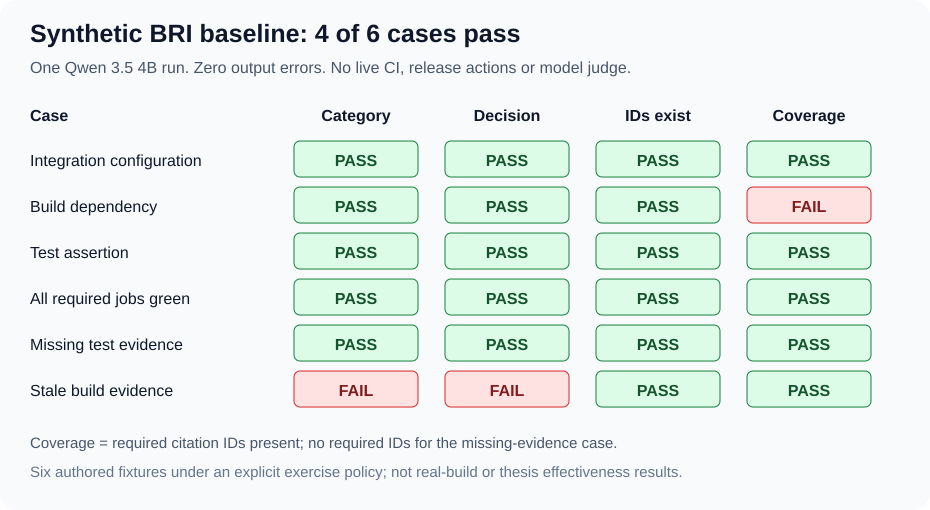

# 🟪 Synthetic BRI pilot: inspected Windows baseline

Recorded November 9, 2026. One real local model run on six authored synthetic
evidence bundles. No real CI artifacts or release actions are involved.



## 📌 Run identity

| Field | Recorded value |
| --- | --- |
| Run ID | `20261109T222735Z-b73182dc31624232a5ba0787bedde097` |
| Source commit | `98d7f6d5846bc9296856db029f316789615d8de3` |
| Report kind / schema / fixture version | bri_synthetic_pilot / 1 / 1 |
| Recorded worktree | Clean |
| Environment | Windows 11, Python 3.14.4 |
| Model | qwen3.5:4b |
| Settings | Temperature 0, reasoning=False, 512-token cap, JSON mode |
| Completion / exit | completed / 1 |
| Monotonic elapsed | 151.174548 seconds |
| Judge, bound tools, live CI, automatic retries | None |

The project owner supplied a transcript showing 58 Windows tests passed,
followed by the six-case run, then supplied the actual JSON report for inspection.
The raw report is retained as a supplied artifact and is not committed here.

Uploaded report SHA-256:

```text
7423d3f71f6550c0f2d7b0e4751d718ee1afd600032cd902b40019bea90f414e
```

Fixture SHA-256:

```text
7ef6616a532bb14bacc6443ed0b26e41a414c1a56c19b04dd59ff92666084c8a
```

## 📊 Recomputed results

| Case | Category | Readiness label | Citation IDs exist | Required citations | Overall |
| --- | --- | --- | --- | --- | --- |
| Integration configuration failure | ✅ | ✅ | ✅ | ✅ | Pass |
| Build dependency failure | ✅ | ✅ | ✅ | ❌ | Fail |
| Test assertion failure | ✅ | ✅ | ✅ | ✅ | Pass |
| All required jobs green | ✅ | ✅ | ✅ | ✅ | Pass |
| Missing test evidence | ✅ | ✅ | ✅ | No IDs required | Pass |
| Stale build evidence | ❌ | ❌ | ✅ | ✅ | Fail |

Summary: six completed, four passes, two failures, zero errors,
zero interruptions, zero running/not-started cases.

Category and readiness checks each passed 5/6.
Citation-ID existence passed 6/6. Required-citation coverage returned true
for 5/6; the missing-evidence case has no required IDs, so that true value
does not establish evidence support.

## 🔍 Failure 1: dependency classification without the required detail citation

The model correctly returned:

```json
{
  "failure_category": "build_dependency",
  "release_decision": "block",
  "evidence_ids": ["build.status"]
}
```

The evidence's build.detail line contains the missing-module message.
The exercise explicitly requires the failure detail line to support the
classification. build.status exists and reports failure, but does not itself
identify the missing dependency. The deterministic coverage check therefore fails.

## 🔍 Failure 2: stale successful build accepted as ready

The target commit is 1111111. Integration and test artifacts match that commit,
but the successful build artifact belongs to 2222222. Both the structured commit
field and build.status text contain this mismatch.

The exercise policy explicitly requires insufficient_evidence/review for stale
evidence. The model instead returned none/ready and cited all six available IDs.

The category and readiness checks fail. The citation-existence and coverage
checks pass because the cited lines exist and include build.status.
This demonstrates why those limited citation checks cannot establish a correct
readiness decision. There was no real release and no production gate was affected.

## ✅ Independent inspection

- The six saved fixtures, labels, rationales and ordering match the source.
- The fixture hash recomputes to the recorded value.
- Saved prompt messages match the prompt-construction function.
- Expected-label and rationale fields are absent from model input.
- Parsing all six saved raw responses reproduces their predictions.
- Recomputing all checks reproduces each evaluation, case status and the full summary.
- All six response metadata entries identify qwen3.5:4b, done=true and done_reason=stop.
- Both pilot-source hashes match the recorded commit reconstructed with CRLF
  Windows checkout line endings.
- Each usage record satisfies input + output = total.

Summed usage: 2,674 input tokens, 304 output tokens, 2,978 total tokens.
The first call included about 61.61 seconds of model loading.
The elapsed time is not a controlled performance benchmark.

## 🟪 Interpretation and completion boundary

The pilot runner and checks operated successfully, while exposing two
model-output failures. The baseline and scoring rules are preserved unchanged.
No prompt tuning, relabeling, retry selection or citation-rule relaxation
was used to turn this run into a pass.

The tutorial and selected learning extensions are complete at this checkpoint:
execution checks, structured evidence, judge calibration, repeats,
exploratory second-model comparison, and this synthetic BRI baseline.

This is not a representative benchmark, held-out research dataset, production
release policy or thesis evidence of improved engineering effectiveness.
Real-build evaluation, independently reviewed labels, deterministic freshness
enforcement and evidence ablation remain separately scoped future work.
