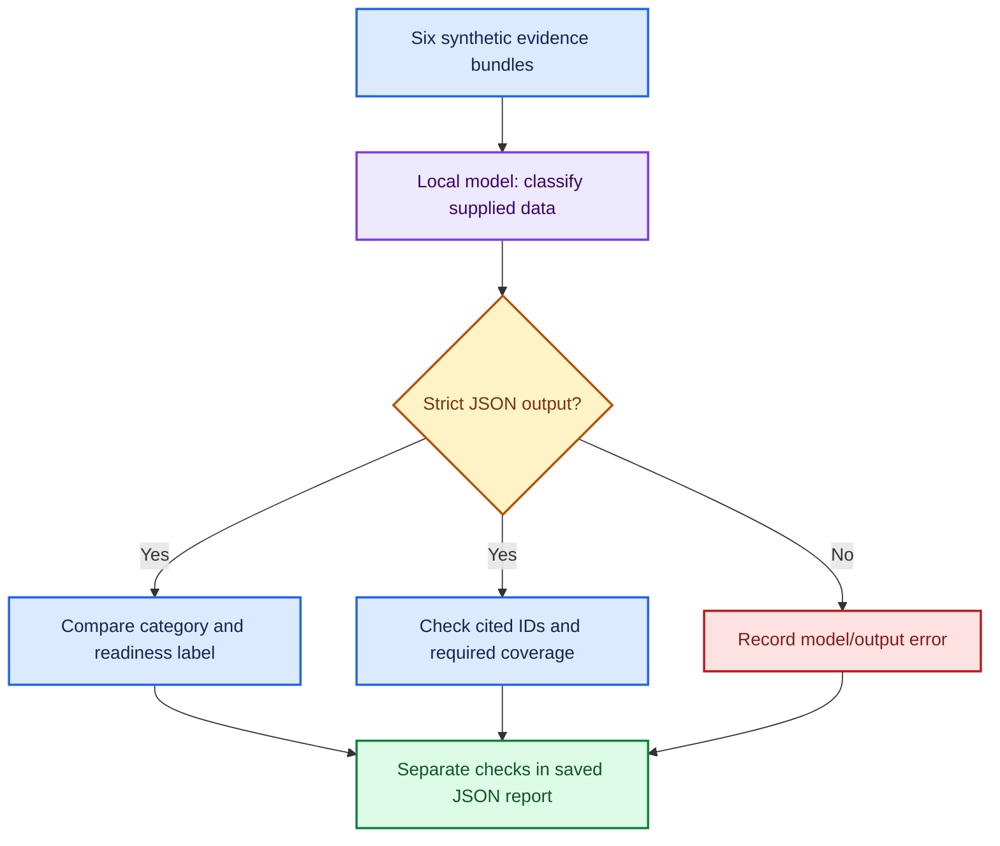

# 🟪 Extension 4: synthetic BRI evaluation pilot

**🟢 Verified: 58 tests passed on Linux (Python 3.12.14) and Windows
(Python 3.14.4). One inspected Qwen model run produced 4/6 complete passes,
two model-output failures and zero output errors.**

[Read the baseline audit and colored results matrix](bri-pilot-verification-20261109.md).

This learning extension classifies six authored Build Release and Integration
evidence bundles. It is separate from the freeCodeCamp tutorial and previous
judge calibration.

**No live CI runs, repository changes, tool execution, or release actions occur.**
A local model classifies supplied synthetic data; no LLM judge evaluates it.

## 🧪 Cases and authored expectations

| Case | Failure category | Readiness label | Required citations |
| --- | --- | --- | --- |
| 🧩 Invalid configuration | integration_configuration | block | integration.detail |
| 🛠️ Missing dependency | build_dependency | block | build.detail |
| 🧪 Assertion failure | test_assertion | block | test.detail |
| 🟢 Required jobs green | none | ready | All three status lines |
| 🟡 Test evidence missing | insufficient_evidence | review | None required |
| 🟠 Build evidence stale | insufficient_evidence | review | build.status |

The exact input is defined in [bri_pilot.py](../bri_pilot.py).
All case IDs, commits, log lines, status values and labels are synthetic.
They are not extracted from the user's Home Assistant, PX4, or other research repos.

The target commit is the placeholder 1111111; the stale build uses 2222222.
Required jobs are integration, build and test. These fixtures do not model a
complete CI dependency graph.

## 🧭 Evaluation design



The system prompt explicitly states the exercise's mapping and policy:
check completeness/freshness first, block the specified failures, and label
complete current green evidence ready. A pass demonstrates structured
classification and citation behavior on these examples, not discovery of
unknown root causes or a validated production release policy.

Expected labels and rationales are not sent to the model. The report retains
them for deterministic scoring.

## 📋 Output contract

The model must return exactly these three fields:

```json
{
  "failure_category": "build_dependency",
  "release_decision": "block",
  "evidence_ids": ["build.detail"]
}
```

The parser rejects malformed JSON, duplicate fields, unknown categories,
unknown readiness labels, unexpected fields, wrong types, duplicate citation IDs,
unexpected tool calls, and length-truncated generations.

Deterministic checks compare both labels, reject nonexistent citation IDs,
and require the relevant authored citations. Additional IDs are allowed if
they exist in the evidence. Missing-evidence cases require no mandatory citation.

ID existence and expected coverage are limited grounding checks.
They do not establish the truth of an artifact, full semantic support of every
claim, realistic root-cause accuracy, or production readiness.

## ▶️ Windows run

```powershell
.\.venv\Scripts\python.exe -m unittest discover -s tests -v
$env:CHAT_MODEL = "qwen3.5:4b"
.\.venv\Scripts\python.exe -u .\eval_bri.py
$runExit = $LASTEXITCODE
Write-Output "Synthetic BRI pilot exit code: $runExit"
```

The runner makes six direct model calls, with no tools bound and no model judge.
It uses temperature 0, reasoning=False, num_predict=512, JSON output mode,
and a 120-second client timeout setting. There are no automatic retries.
The timeout is not a total wall-clock deadline for the suite.

Each case is invoked independently, without shared conversation history.
Existing personal notes and fact databases are not used.

## 📦 Reports

Output is checkpointed under:

```text
results/bri-pilot/<run-id>/report.json
```

The report records:

- report_kind=bri_synthetic_pilot, fixture version and hash;
- data_kind=authored_synthetic and explicit no-live-CI/no-judge flags;
- full input evidence, authored labels, exact prompts and parsed predictions;
- named deterministic checks, raw model responses and returned metadata;
- UTC timestamps, monotonic durations, package versions and source provenance;
- the two pilot-source file hashes, alongside inherited source hashes.

Generated reports remain ignored by Git until deliberately shared.
They are editable local evidence, not an immutable audit store.

Exit 0 means all six examples pass. Exit 1 means at least one disagreement,
output/invocation error, or run error. Exit 130 records an interrupted run.
Completed cases and partial state are preserved using the existing evidence writer.

## 🧪 Offline validation boundary

The existing 41 tests plus 17 new pilot tests passed locally without Ollama.
Tests use authored expected predictions and fabricated responses; they are
checker and report-persistence tests, not model evaluation results.

They cover hidden labels, wrong classifications, missing/stale readiness,
invented and missing citations, malformed/truncated JSON, duplicate keys,
unsupported tool calls, invocation errors and interrupted runs.

## 🟪 Research transition

This is a small portfolio and learning bridge toward BRI evaluation.
It provides no measured engineering-efficiency improvement, no human baseline,
no held-out dataset, no artifact-authenticity validation and no real-build result.

The first report has been inspected. Suitable future research work would be
identified real build artifacts, independently reviewed labels, baseline
comparisons, evidence ablation and broader repeated-run evaluation.
Those belong to a separately scoped evaluation study.
