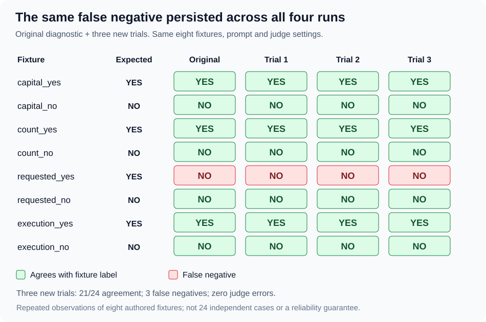

# 🔁 Calibration repeats: inspected Windows batch

Recorded November 9, 2026.



## 📌 Protocol and evidence

The project owner ran exactly three additional trials using the existing
`eval_calibration.py`, with `JUDGE_MODEL=qwen3.5:4b`, separate output
directories, and no changes to fixtures or prompts between trials.
Expected exit code 1 was preserved and did not stop the batch.

The owner supplied both the terminal transcript and
`calibration-repeat-20261109-125927.zip`, containing three complete reports
and a batch summary. All three reports were inspected and the batch summary
was recomputed from their saved responses.

The original [calibration run](calibration-verification-20261109.md) is
separate from these three trials. All four evaluate the same eight fixtures.

## 📊 Three new trials

| Trial | Agreement | False negatives | False positives | Judge errors | Elapsed seconds | Exit |
| --- | --- | --- | --- | --- | ---: | --- |
| 1 | 7/8 | 1 | 0 | 0 | 36.992791 | 1 |
| 2 | 7/8 | 1 | 0 | 0 | 34.290508 | 1 |
| 3 | 7/8 | 1 | 0 | 0 | 31.297671 | 1 |

New-trial totals: **21 correct verdicts out of 24 valid observations (87.5%)**.
Aggregated confusion counts: 9 true positives, 3 false negatives,
0 false positives, and 12 true negatives. All cases completed normally.

## 🚦 Per-fixture verdict counts in new trials

| Fixture | Expected | YES | NO | Errors |
| --- | --- | ---: | ---: | ---: |
| capital_yes | YES | 3 | 0 | 0 |
| capital_no | NO | 0 | 3 | 0 |
| count_yes | YES | 3 | 0 | 0 |
| count_no | NO | 0 | 3 | 0 |
| requested_yes | YES | 0 | 3 | 0 |
| requested_no | NO | 0 | 3 | 0 |
| execution_yes | YES | 3 | 0 | 0 |
| execution_no | NO | 0 | 3 | 0 |

All eight verdicts were identical across the three new trials.
The requested_yes false negative also occurred in the original diagnostic:
it was observed in **4/4 recorded calibration runs**.

Adding the original run gives 28/32 agreement observations, still 87.5%.
Those are repeated observations of eight authored fixtures, not 32 independent
test cases. No new unique-case coverage was added.

## 🔎 Inspection checks

- Each report contains exactly eight complete cases and normal stop metadata.
- Saved fixtures and prompt messages match the frozen source construction.
- Fixture version/hash, expected labels, system prompt and judge configuration
  match across trials.
- Calibration source hashes match the prior inspected source hashes.
- The six inherited execution-source hashes are identical across the three reports.
- All three reports record clean worktrees at commit
  `46d799f485ee543bc327c73562e8509acd662117`.
- Raw response parsing reproduces every saved verdict and case status.
- Recomputed summaries reproduce category counts, confusion matrices and ratios.
- The submitted batch summary matches all three reports and all eight case rows.
- Every response identifies qwen3.5:4b and reports done=true, done_reason=stop.
- Input plus output equals total tokens in every returned usage record.

Per trial: 1,497 input tokens, 16 output tokens, 1,513 total tokens.
Across the three trials: 4,491 input, 48 output, 4,539 total tokens.

A stable model tag and recorded settings do not establish an identical model
binary: these reports do not record an Ollama model digest. Decreasing elapsed
times are not evidence of performance improvement in this uncontrolled batch.

## 🔐 Artifact fingerprints

The uploaded ZIP is retained as a supplied artifact and is not committed
to this public repository.

ZIP SHA-256:

```text
ba7f02146e1b91f66d338b82f16518dd32d8af815901ce0b61acb55c6c4502ab
```

| Trial | Run ID |
| --- | --- |
| 1 | `20261109T205928Z-0d8c5cb3b328403aa48b77061c8f48aa` |
| 2 | `20261109T210006Z-2f4a474af8d64cfbb30f901d4a5e6e54` |
| 3 | `20261109T210044Z-952d6006ee95490fad17bbf0f9cc64ac` |

Report SHA-256 values, in trial order:

```text
768afab507e19d4eb8bdd5968e3958f75384a920eaa9dd66748386a4c4a334f4
04dc1473fe084f61b1baa965e43ce111ee18a6ee66f9081f329eb5eef96a8b5e
5d728b9cbee72e21cb3ab16f06a79b0e4ba8df496aee1cdd1a8760f90973d95c
```

## 🟪 Finding and next scope

The false negative persisted under the recorded repeated-run conditions.
The reports do not establish why the judge rejected requested_yes, general
model reliability, or broad accuracy on engineering tasks.

This same-model consistency check is complete. More identical reruns are not
needed for this checkpoint. Model comparison and BRI-specific cases remain
separate extensions; deterministic execution checks continue to provide direct
evidence for the tool behavior they validate.
