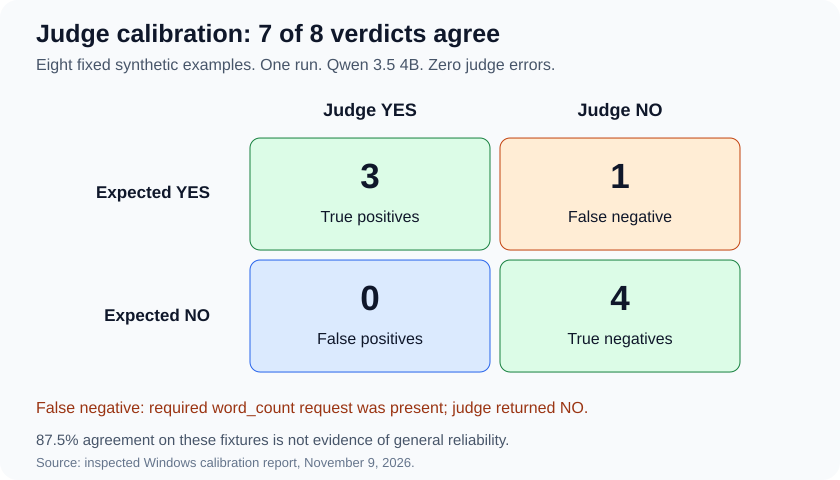

# 🧑‍⚖️ Windows judge calibration: inspected report

Recorded November 9, 2026. One supplied model run, eight fixed synthetic fixtures.



## 📌 Run identity

| Field | Value |
| --- | --- |
| Run ID | `20261109T095313Z-009b475027e64433ac08c2c569005379` |
| Source commit | `a36def3f5b519ec8e9ad9c5ea76c1de77a5d283c` |
| Report kind / schema / fixture version | judge_calibration / 1 / 1 |
| Recorded worktree | Clean |
| Environment | Windows 11, Python 3.14.4 |
| Judge | qwen3.5:4b |
| Configuration | Temperature 0, reasoning disabled, 128-token cap |
| Completion / exit | completed / 1 |
| Monotonic elapsed time | 37.029701 seconds |
| Automatic retries / agent invocations | 0 / 0 |

The project owner supplied a terminal transcript showing all 41 offline tests
passed on Windows, followed by the calibration run. The attached report was then
inspected. This document records the audit; the raw uploaded report is not
committed to this repository.

Uploaded file SHA-256:

```text
b2983c5db68d7bc2c53a6d53a42d02777ab839473d62c93063dc3262e428e944
```

Fixture SHA-256:

```text
f597f8248d9630bde3f4023b581e182da6e1437e50c3b35b06fb101dd6bb9cfa
```

## 📋 Per-fixture results

| Fixture | Expected | Judge | Outcome |
| --- | --- | --- | --- |
| capital_yes | YES | YES | ✅ Agree |
| capital_no | NO | NO | ✅ Agree |
| count_yes | YES | YES | ✅ Agree |
| count_no | NO | NO | ✅ Agree |
| requested_yes | YES | NO | 🟠 False negative |
| requested_no | NO | NO | ✅ Agree |
| execution_yes | YES | YES | ✅ Agree |
| execution_no | NO | NO | ✅ Agree |

| Category | Agreement |
| --- | --- |
| Answer quality | 4/4 |
| Tool requests | 1/2 |
| Execution success | 2/2 |
| Overall | 7/8 (87.5%) |

Eight of eight verdicts were valid, with zero errors, interruptions, running
cases, or not-started cases. All eight returned done=true and done_reason=stop.
There were 3 true positives, 1 false negative, 0 false positives and 4 true negatives.

## 🔍 The false negative

The requested_yes evidence includes:

- A question ending with “Avoid tool use”.
- A rubric requiring a word_count request.
- A word_count call with ID call-1 and the exact five-word phrase.
- A matching successful result with content 5.
- A judge system instruction to use tool_calls rather than answer claims,
  and to apply the rubric despite a conflicting user request.

The judge returned a complete NO in 3.1299 seconds. This is a disagreement with
the fixture label, not an empty-response error or token-limit event.
The report contains no explanation for the verdict; its underlying cause
remains unresolved.

This resembles the earlier tutorial disagreement, but uses a different prompt
and synthetic evidence. It is not a controlled reproduction or proof that the
conflicting wording caused the verdict. The fixtures and prompts were not
modified after this run to obtain a passing result.

## ✅ Independent inspection

- Fixture fields, ordering, labels, rationales and fixture hash match the
  version-1 source at the recorded commit.
- Saved prompt messages match the prompt-construction function exactly.
- Expected-label and rationale fields were absent from the JSON sent to the judge.
- Parsing each saved raw response reproduces the recorded verdict.
- Recomputing the summary reproduces all counts, ratios, categories and matrix cells.
- Both calibration source-file hashes match the recorded commit's content
  reconstructed with CRLF Windows line endings.
- The six inherited execution-related file hashes are unchanged from the
  previously inspected execution report.
- All eight response metadata entries identify qwen3.5:4b and normal completion.

Summed usage across eight calls: 1,497 input tokens, 16 output tokens,
1,513 total tokens. Every call's input plus output equals its recorded total.
The first call included model loading; elapsed time is not a controlled benchmark.

## 🟪 Interpretation and boundaries

The checker suite passed, and the calibration runner successfully exposed a
model-judge disagreement. Exit 1 correctly signals less than full label agreement;
it is not evidence of a program crash.

These are eight authored, balanced fixtures in one run. The results are not
general accuracy estimates, independent research annotations, or grounds for
using the judge as the sole release gate. Deterministic execution checks remain
the appropriate source for the tool evidence they can verify.

Next: repeated-run analysis using the frozen fixtures, with model comparisons
only if justified. BRI cases remain a future research adaptation.
