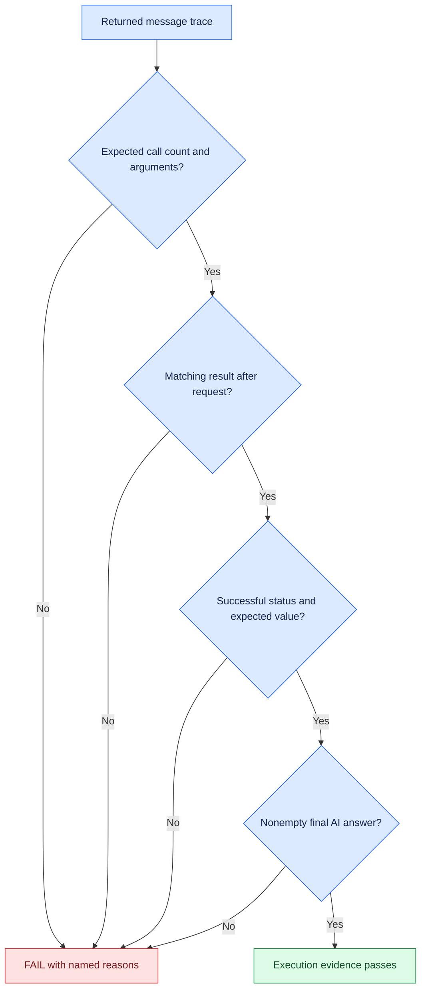

# 🔧 Extension 1: validate tool execution evidence

**Status: verified in one Windows model-driven run: 4/4 cases passed, zero
agent/trace errors, exit code 0. All 15 offline checker tests passed on Windows
and Linux (Python 3.12.14). Windows used Python 3.14.4.**

See the [November 9 Windows evidence record](windows-execution-20261109.md).
The model judge was not invoked; its earlier disagreement remains recorded.

This extension adds a separate deterministic runner. The original
[eval.py](../eval.py), its model judge, snapshots, and recorded results remain
the tutorial reference.

## 🧩 What changes

| Evidence layer | Tutorial harness | Execution extension |
| --- | --- | --- |
| Expected tool | Name occurs in requested calls | Exactly one expected call; zero for no-tool case |
| Arguments | Not checked | Exact dictionary match |
| Tool result | Not checked | One result paired to the call ID, after the request |
| Execution status | Not checked | Reject explicit error status |
| Word-count value | Answer substring only | Tool result must serialize integer 5 |
| Time value | Answer contains colon | Parse exact seconds timestamp inside invocation window |
| Final message | Text assumed | Require nonempty final AI message with no pending/invalid calls |
| Judge | Invoked | Not invoked |

The time comparison uses the same local clock as the tool and accepts the
start second because tool output omits microseconds. A local clock adjustment
during a run can affect this check. It does not verify external clock accuracy.

## 🚦 Validation flow



The runner also retains the tutorial keyword check. Case 4 still skips that
keyword check. The extension does not claim to validate final-answer semantics
or whether the final answer names the tool.

## ▶️ Run offline tests first

From the repository root:

```powershell
.\.venv\Scripts\python.exe -m unittest discover -s tests -v
```

The 15 test methods use synthetic message objects and require neither LangChain
nor Ollama. They test the checker, not the model. Cases include missing and
duplicate results, wrong arguments, mismatched IDs, explicit tool errors, extra
calls, malformed calls, pending answers, and stale/future/invalid timestamps.

## 🤖 Run the agent evaluation separately

```powershell
$env:CHAT_MODEL = "qwen3.5:4b"
$stamp = Get-Date -Format "yyyyMMdd-HHmmss"
.\.venv\Scripts\python.exe -u .\eval_execution.py 2>&1 |
    Tee-Object -FilePath ".\execution-$stamp.log"
$runExit = $LASTEXITCODE
Write-Output "Execution runner exit code: $runExit"
```

The four prompts are reused from the tutorial harness; expected arguments and
values are explicit in the extension. Each case receives a unique thread ID.
The current agent has no checkpointer or storage tools. A future memory-enabled
adaptation also needs isolated note/fact storage.

The agent configuration is reused unchanged, so its model call still has no
explicit generation cap or client timeout. A graph recursion limit is not a
wall-clock timeout. The runner prints before each case so a slow invocation
is visible.

The runner exits 0 only when all four cases pass. It reports invocation and
trace exceptions separately. Extension 2 now adds checkpointed JSON reports
and returned-message generation metadata; see the [structured evidence guide](structured-evidence.md).
The 4/4 Windows evidence above predates that persistence change; a new Windows
verification of JSON reporting is pending.

## 🟪 Why this matters for BRI

A requested build-log tool name does not establish that the right artifact
was retrieved. This extension practices argument and result validation on
simple tools before introducing build logs or release evidence.

These checks inspect returned traces. They do not independently audit side
effects, authenticate evidence, or prove that an arbitrary agent trace is
truthful. BRI cases and model-judge calibration are future work.

## 📁 Implementation

- [execution_checks.py](../execution_checks.py): dependency-free trace checker.
- [eval_execution.py](../eval_execution.py): separate four-case agent runner.
- [test_execution_checks.py](../tests/test_execution_checks.py): offline failure-oriented tests.
