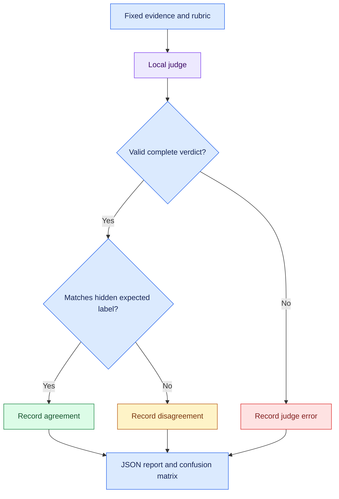

# 🧑‍⚖️ Extension 3: judge calibration diagnostics

**🟢 Implemented; all 41 offline tests passed on Linux, Python 3.12.14.
🟡 First Windows calibration-model run is pending.**

The judge scores eight fixed, labeled synthetic examples. No agent is invoked.
This separates evaluator behavior from agent generation and preserves the
earlier tutorial disagreement as historical evidence.

Here, calibration means checking verdict agreement against explicit labels.
It does not estimate or calibrate probability/confidence scores.

## 🧪 Fixed fixtures, version 1

| Category | Positive example: expected YES | Negative example: expected NO |
| --- | --- | --- |
| 🌍 Capital answer | Answer says Paris | Answer says Lyon |
| 🔢 Count answer | Answer says 5 | Answer says 4 |
| 🔧 Tool request | Trace contains word_count despite “Avoid tool use” | Answer claims tool use but trace is empty |
| ✅ Execution success | Matching call/result, exact phrase, status success, result 5 | Matching result reports status error |

There are four YES labels and four NO labels. Expected labels and rationales
are stored in the report but never sent to the judge. The system prompt directs
the judge to evaluate the rubric and treat the supplied evidence as data.

These are authored diagnostic fixtures, not independently annotated research
data, a representative benchmark, or a held-out evaluation set.
Use broader independently reviewed cases before drawing thesis conclusions.

## 🧭 Calibration flow



## 🚦 Confusion matrix interpretation

| Expected label | Judge YES | Judge NO |
| --- | --- | --- |
| YES | True positive | False negative |
| NO | False positive | True negative |

Errors never enter the confusion matrix. Empty or invalid text, unexpected
tool calls, invocation exceptions, and done_reason=length are errors.
A truncated response is rejected even when its visible content is YES or NO.
Raw returned content and metadata are preserved before parsing.

| Metric | Definition |
| --- | --- |
| valid_coverage | Valid verdicts / all eight cases |
| agreement_on_valid | Correct verdicts / valid verdicts; null if none |
| correct_over_all_cases | Correct verdicts / all eight cases |
| disagreements | Valid YES/NO verdicts that differ from labels |
| errors | Invocations or responses that cannot be scored |

Per-category totals count started cases. On an interrupted run, also inspect
not_started, interrupted, and running counts.

## ▶️ Windows run

```powershell
.\.venv\Scripts\python.exe -m unittest discover -s tests -v
$env:JUDGE_MODEL = "qwen3.5:4b"
.\.venv\Scripts\python.exe -u .\eval_calibration.py
$runExit = $LASTEXITCODE
Write-Output "Calibration exit code: $runExit"
```

The runner makes eight judge requests, with temperature 0, reasoning=False,
num_predict=128, and a 120-second client timeout setting. That timeout is not
a total suite deadline. There are no automatic retries and no model fallback.
Cases have no shared conversation history.

Exit 0 means all eight match the expected labels. Exit 1 means a disagreement,
judge error, or run error; it does not necessarily mean the program crashed.
Exit 130 records a handled KeyboardInterrupt.

## 📦 Evidence

The runner checkpoints:

```text
results/calibration/<run-id>/report.json
```

Report kind is judge_calibration. It records fixture version/hash, prompt
messages, system policy, labels/rationales, raw response messages, metadata,
timing, model configuration, source provenance, and summary counts.

The inherited evidence writer also records the six existing execution-related
source hashes. A separate calibration_source_sha256 field records the two
calibration source files. Generated reports remain ignored by Git.

Ctrl+C preserves completed results and the interrupted case. A forced process
termination may leave the last saved report marked running.

To inspect the latest calibration report:

```powershell
$latest = Get-ChildItem .\results\calibration -Recurse -Filter report.json |
    Sort-Object LastWriteTime -Descending |
    Select-Object -First 1
if (-not $latest) { throw "No calibration report found." }

$report = Get-Content $latest.FullName -Raw -Encoding utf8 | ConvertFrom-Json
$report.summary | ConvertTo-Json -Depth 6
$report.cases |
    Select-Object case_id, expected_label, verdict, status, elapsed_seconds |
    Format-Table -AutoSize
Write-Output "Report: $($latest.FullName)"
```

## 🧩 What differs from the tutorial judge

The calibration prompt explicitly separates question/answer data from evaluation
instructions, includes a system policy, and supplies structured synthetic trace
evidence. The original tutorial harness is unchanged.

This is a new evaluator configuration, not an exact reproduction of the
earlier NO verdict. A better calibration result would not erase that observation.

## 🟪 Portfolio and research connection

A judge should be checked against known labels before it is used to assess
build-failure diagnoses or release evidence. A false positive may accept a
failed execution; a false negative may reject correct evidence.

This small diagnostic can reveal issues worth investigating. Even 8/8 agreement
would not demonstrate general reliability or justify using the judge as the
sole release gate.

The existing suite has 26 execution/report tests plus 15 calibration tests.
All offline model responses are fabricated test fixtures, not measured judge
results. Real model results will be recorded only after the Windows run.
