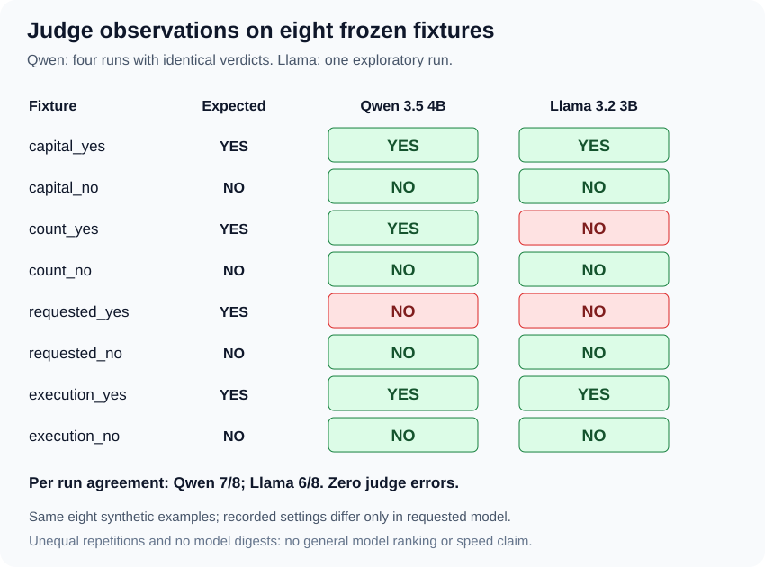

# 🔎 Exploratory judge-model comparison

Recorded November 9, 2026. One inspected Llama run compared with the previously
inspected Qwen diagnostic and three unchanged repeat trials.



## 📊 Observed results

| Judge | Recorded runs | Agreement per run | False negatives per run | False positives | Judge errors |
| --- | ---: | --- | --- | --- | --- |
| qwen3.5:4b | 4 | 7/8 (87.5%) | requested_yes | 0 | 0 |
| llama3.2:3b | 1 | 6/8 (75%) | count_yes, requested_yes | 0 | 0 |

These are observations on eight authored synthetic fixtures, with unequal
repetitions. They do not establish a general ranking, comparative reliability,
or performance advantage.

## 📌 Llama run identity

| Field | Value |
| --- | --- |
| Run ID | `20261109T210851Z-1a92a2db761c4f9ba11b4575f3068305` |
| Source commit | `6398950b57e1b86aa32ccdd979c4b830fe8d9d44` |
| Recorded worktree | Clean |
| Environment | Windows 11, Python 3.14.4 |
| Fixture version | 1 |
| Requested and returned model | llama3.2:3b |
| Settings | Temperature 0; reasoning=False; num_predict=128; 120-second client timeout |
| Automatic retries / agent invocations | 0 / 0 |
| Completion / exit | completed / 1 |
| Monotonic elapsed | 16.023098 seconds |

The project owner supplied the console output and then attached the saved
report for inspection. The raw report is retained as a supplied artifact and
is not committed to this public repository.

Uploaded report SHA-256:

```text
5c2c187b40b38009364a418f33e67ef50fbd00e07d436866bc575c96f27dc187
```

## 🚦 Per-fixture verdicts

| Fixture | Expected | Qwen verdict in each recorded run | Llama verdict |
| --- | --- | --- | --- |
| capital_yes | YES | YES | YES |
| capital_no | NO | NO | NO |
| count_yes | YES | YES | NO |
| count_no | NO | NO | NO |
| requested_yes | YES | NO | NO |
| requested_no | NO | NO | NO |
| execution_yes | YES | YES | YES |
| execution_no | NO | NO | NO |

Llama confusion counts: 2 true positives, 2 false negatives, 0 false positives,
4 true negatives. All eight verdicts are valid; there are no invocation or
parsing errors.

### 🔢 count_yes

The supplied question asks for the count in
“LangChain makes tool calling easier”. The answer says “There are 5 words.”
The rubric asks whether the answer gives a word count of 5.
Llama returned a complete NO. The response includes no explanation,
so the underlying cause is unresolved.

### 🔧 requested_yes

The trace contains a word_count request and matching successful result.
The rubric asks whether that request occurred. Llama returned NO,
matching Qwen's false-negative pattern. This does not establish a shared
internal cause or show that the question's conflicting wording caused it.

## ✅ Independent inspection

- The fixture hash recomputes to the frozen version-1 hash.
- All fixture fields, labels, rationales, order and evidence match source.
- All eight saved prompt-message pairs match the Qwen repeat reports exactly.
- Expected labels and rationales are absent from judge input.
- The only recorded configuration difference is requested_judge_model.
- Both calibration-source hashes and all six inherited source hashes match
  the inspected Qwen repeat reports.
- Parsing raw responses reproduces each verdict and status.
- Recomputing summary metrics reproduces the entire recorded summary.
- Every response identifies llama3.2:3b, done=true and done_reason=stop.
- Each usage entry's input plus output equals its total.

Llama usage summed across calls: 1,561 input tokens, 16 output tokens,
1,577 total tokens. Different tokenizers can produce different counts for
identical prompt text.

The first Llama call included about 6.49 seconds of model loading.
The 16.02-second run is not a controlled speed comparison with Qwen.
The reports do not include Ollama model digests or an independent check of
each model's effective runtime defaults.

## 🟪 Scope and next step

The exploratory model comparison is complete. Both judges produced false
negatives on this small set. Deterministic checks remain the direct evidence
for tool-call and execution properties they can validate.

More identical reruns or prompt changes are unnecessary for this checkpoint.
A small BRI-specific evaluation pilot can now apply the established separation
between deterministic evidence and model judgment. It must be labeled as
synthetic unless it uses identified real build artifacts and reviewed labels.

Related evidence:
[Qwen diagnostic](calibration-verification-20261109.md) ·
[Three repeat trials](calibration-repeats-20261109.md).
