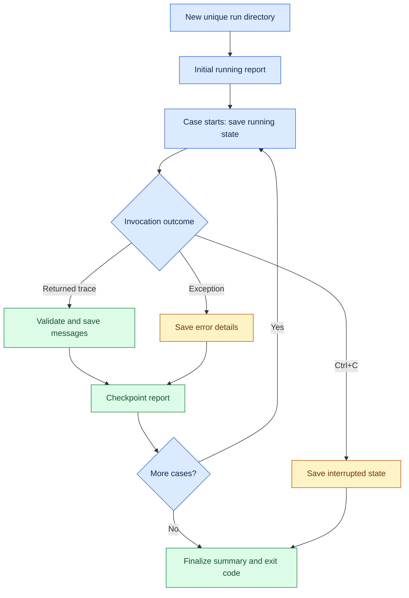

# 📦 Extension 2: structured execution evidence

**🟢 Implemented and tested offline: 26 tests passed on Linux, Python 3.12.14.
🟡 Windows tests and a real Ollama JSON-report run are pending.**

The existing execution runner now writes a versioned UTF-8 JSON report per run.
It still evaluates the same four cases without invoking an LLM judge.
The previously verified Windows execution run is documented separately in
[the November 9 record](windows-execution-20261109.md).

## 🧭 Evidence lifecycle



## 🔎 Report contents

| Area | Fields |
| --- | --- |
| Run identity | Schema version 1, UUID-based run ID, UTC start/end, elapsed time |
| Source | Git commit, dirty-worktree flag, SHA-256 hashes for six relevant files |
| Environment | Python, platform, relevant package versions, local timezone names |
| Configuration | Requested agent model, temperature, recursion limit, default settings, no-judge flag |
| Per case | Prompt, rubric reference, expected arguments/value, unique thread ID |
| Timing | UTC case start/end, naive local invocation bounds, monotonic elapsed time |
| Returned trace | Ordered content, calls with arguments and IDs, result IDs/status |
| Model output metadata | Response and usage metadata for each returned message when available |
| Outcome | Named execution checks, keyword pass/fail/skipped, case error details |
| Summary | Pass/fail/error/interrupted/running counts, not-started and completed counts |

Model metadata comes from returned messages. The report does not query the
Ollama server for model digests or its version. Missing metadata remains
missing. Default model settings are labeled as defaults, not inferred values.
Additional reasoning fields are not exported.

The dirty-worktree flag includes untracked files. Source hashes identify file
bytes at run initialization; they are not a signature or tamper-proof audit.

## ▶️ Run on Windows

From the repository root:

```powershell
.\.venv\Scripts\python.exe -m unittest discover -s tests -v
$env:CHAT_MODEL = "qwen3.5:4b"
.\.venv\Scripts\python.exe -u .\eval_execution.py
```

The runner prints the exact report path before case 1 and at completion:

```text
results/<UTC-timestamp>-<UUID>/report.json
```

Use an explicit alternate directory if needed:

```powershell
.\.venv\Scripts\python.exe -u .\eval_execution.py --output-dir .\results
```

Generated /results/ directories and /execution-*.log files are ignored by Git.
Reports remain local until deliberately shared or committed. Do not interpret
ignored generated reports as published evidence.

## 📋 Inspect the latest report

```powershell
$latest = Get-ChildItem .\results -Recurse -Filter report.json |
    Sort-Object LastWriteTime -Descending |
    Select-Object -First 1

if (-not $latest) { throw "No report.json found." }

$report = Get-Content $latest.FullName -Raw -Encoding utf8 | ConvertFrom-Json
$report | Select-Object schema_version, run_id, run_status
$report.summary | Format-List
$report.cases | Select-Object case_id, status, keyword_status, elapsed_seconds |
    Format-Table -AutoSize
Write-Output "Report: $($latest.FullName)"
```

Review individual messages for call arguments, matching result IDs,
response_metadata, and usage_metadata.

## 🚦 Exit and recovery behavior

| Exit | Meaning |
| --- | --- |
| 0 | All four cases pass |
| 1 | At least one failed/error case, or a setup/run error |
| 130 | KeyboardInterrupt handled; report records interruption |

Each run reserves a fresh directory and updates only its own report.
A complete JSON serialization is written to a temporary file, flushed, then
atomically replaces that run's prior checkpoint. A failed serialization or
replacement leaves the prior checkpoint intact.

Ctrl+C preserves completed cases plus an interrupted case when one was active.
A forced process termination or power loss may leave the last saved report
marked running. No automatic retry or resume is implemented.

No messages from a failed/incomplete invocation are invented; only returned
traces are saved. A write/storage failure is allowed to surface rather than
claiming evidence was saved.

The agent configuration still has no explicit timeout or generation cap.
Report checkpointing does not make a stuck model invocation terminate.

## 🧪 Offline validation

The suite includes the original 15 execution-check tests plus 11 report/runner
tests. These cover Unicode, unique run directories, metadata retention, failed
serialization and replacement, fake-agent success and failure, construction
errors, and interruption. Fake-agent results are test fixtures, not model results.

## 🟪 Research value and next work

This provides inspectable per-case evidence rather than only aggregate counts.
It supports future error analysis and reproducibility work in Build Release
and Integration Engineering. It is not an immutable evidence store.

Next: verify the real Windows report, then add judge calibration with known
positive and negative examples. The earlier tutorial judge disagreement stays
in the historical record.
